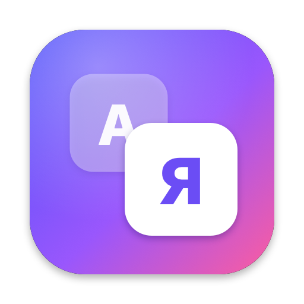
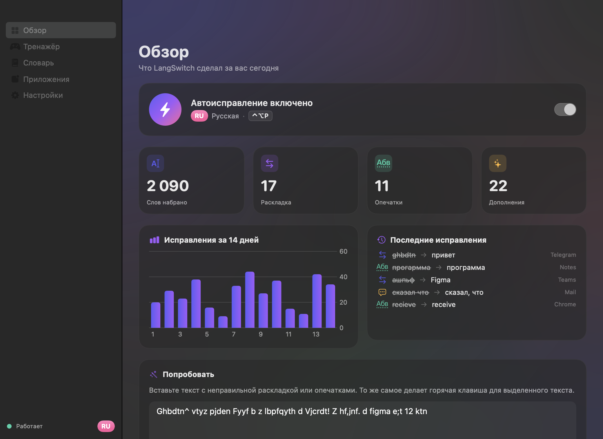
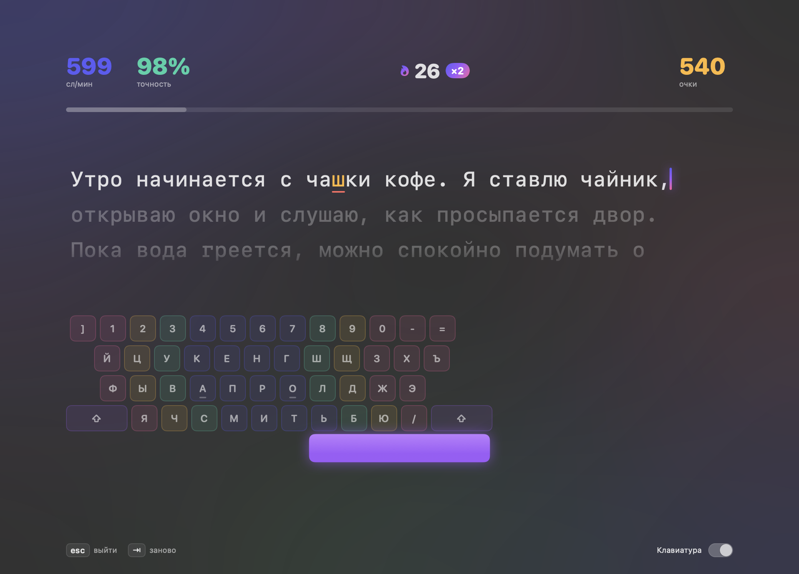

  

<h1 align="center">LangSwitch</h1>

  Type without thinking about the keyboard layout. LangSwitch fixes the layout, typos and punctuation 
  as you type in any macOS application — and teaches touch typing.

<a href="README.md">Русский</a>

## What it does

You type `Ghbdtn^ vtyz pjden Fyyf` with the Latin layout still on — the field shows
«Привет, меня зовут Анна», and the system layout is already Russian. Type `руддщ цщкдв` on the
Russian layout and you get `hello world`.

Product names and commands are left alone: in `Z hf,jnf. d figma e;t 12 ktn` everything becomes Russian
except `Figma`, which only gets its capital letter.

| | |
| --- | --- |
| **Layout** | Decides the language from dictionaries, word frequencies and letter statistics. Leaves `git`, `GitLab`, `gmail`, links, e-mail addresses, `camelCase` and code untouched. |
| **Spelling** | Swapped, missing and doubled letters, neighbouring-key slips, 3,600 common misspellings in Russian and English. |
| **Punctuation** | Commas before Russian conjunctions, a space after a comma, sentence capitals, proper names, `HEllo` → `Hello`. |
| **Autocomplete** | Grey ghost text after the caret, accepted with <kbd>Tab</kbd>. Learns your own vocabulary. |
| **Alternatives** | Double-click a word in any field for spellings, word forms and synonyms. |
| **Trainer** | Touch typing as a game: speed, streaks, levels, records — and drills built from your own mistakes. |
| **Notch** | A brief "before → after" hint grows out of the MacBook notch. |

It works wherever you can type: browsers (address bar included), Telegram, Teams, Zoom, Slack, Mail,
Notes, ChatGPT, Claude, Codex. In terminals and code editors only the layout is fixed by default.

## Install

1. Download `LangSwitch-x.y.z.dmg` from [Releases](https://github.com/AndySobol/LangSwitch/releases)
   and drag the application to Applications.
2. Builds are not notarized yet. On first launch open System Settings → Privacy & Security and click
   "Open Anyway".
3. Grant Accessibility access — the application shows where.

Requires macOS 15 or later and two layouts: Russian and a Latin one (ABC, U.S. and the like).

Build from source: `./scripts/build.sh` (Xcode 26, no dependencies, no network).

## Controls

| Action | Keys |
| --- | --- |
| Undo the last correction | <kbd>⌫</kbd> right after it |
| Convert the last word or the selection | <kbd>⇧</kbd> <kbd>⇧</kbd> or <kbd>⌃</kbd><kbd>⌥</kbd><kbd>L</kbd> |
| Fix the selected text | <kbd>⌃</kbd><kbd>⌥</kbd><kbd>F</kbd> |
| Alternatives for the selected word | double-click or <kbd>⌃</kbd><kbd>⌥</kbd><kbd>S</kbd> |
| Accept a completion | <kbd>Tab</kbd> |
| Pause | <kbd>⌃</kbd><kbd>⌥</kbd><kbd>P</kbd> |

Every shortcut and every kind of correction can be changed or switched off in Settings.

## Privacy

LangSwitch has to see key presses to do its job, so: it is fully offline (there is no networking code),
it cannot see passwords (macOS secure input hides them from every application), it keeps only the current
word and a few previous ones in memory, and it writes only counters and your personal dictionary to disk.
Phrase collection for the trainer is off by default. See [docs/PRIVACY.md](docs/PRIVACY.md) (in Russian).

## How it works

A single native Swift 6 process with no external dependencies, about 10 MB. A `CGEventTap` on a dedicated
thread sees key presses; at a word boundary the engine reads what was typed on both layouts and compares
the readings using Hunspell dictionaries, frequencies and a character trigram model. The edit is made with
ordinary keyboard events, so it works in every text field and keeps the application's own undo intact.
A boundary decision takes about 0.8 ms; at rest the application uses no timers.

## License

[MIT](LICENSE). Hunspell and the dictionaries keep their own terms —
see [THIRD_PARTY_NOTICES.md](THIRD_PARTY_NOTICES.md).
