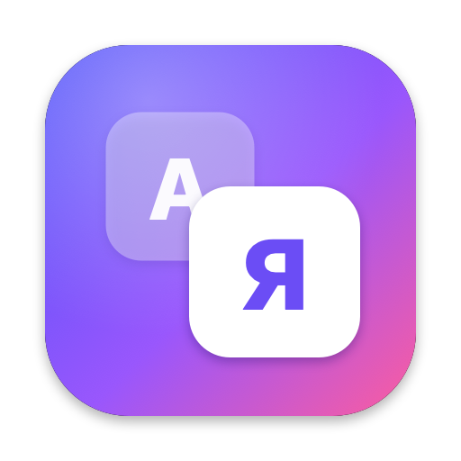
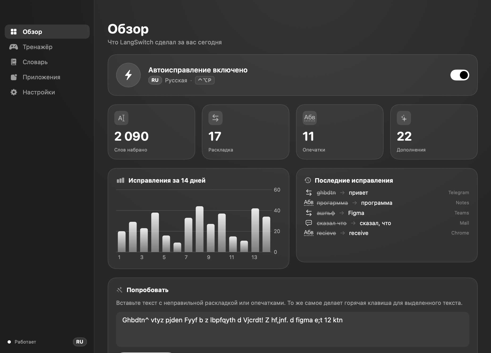
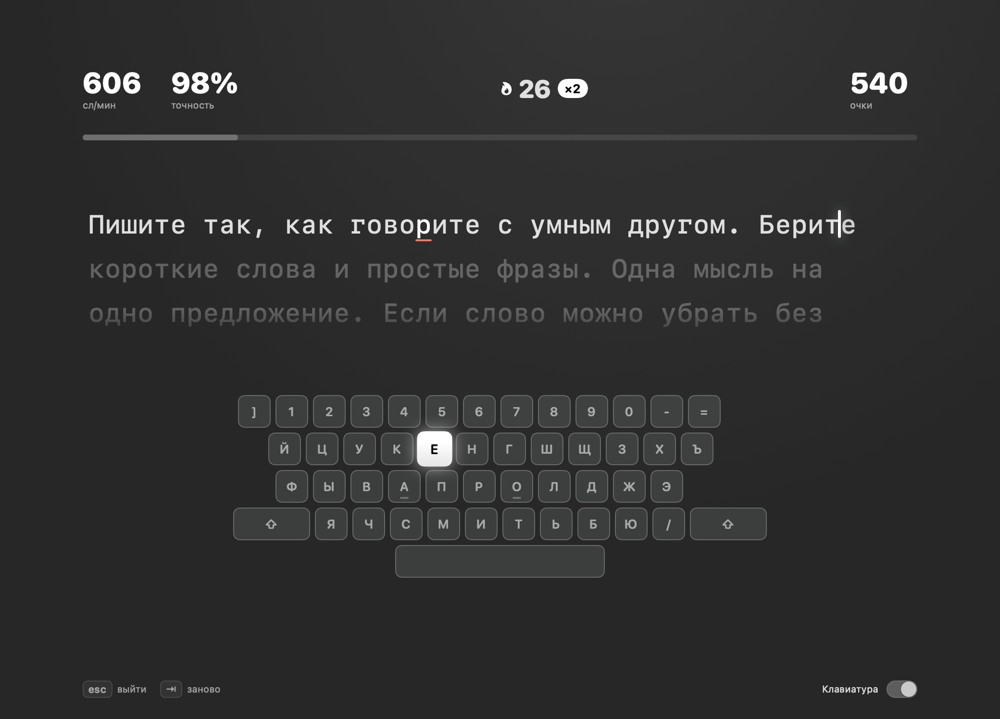
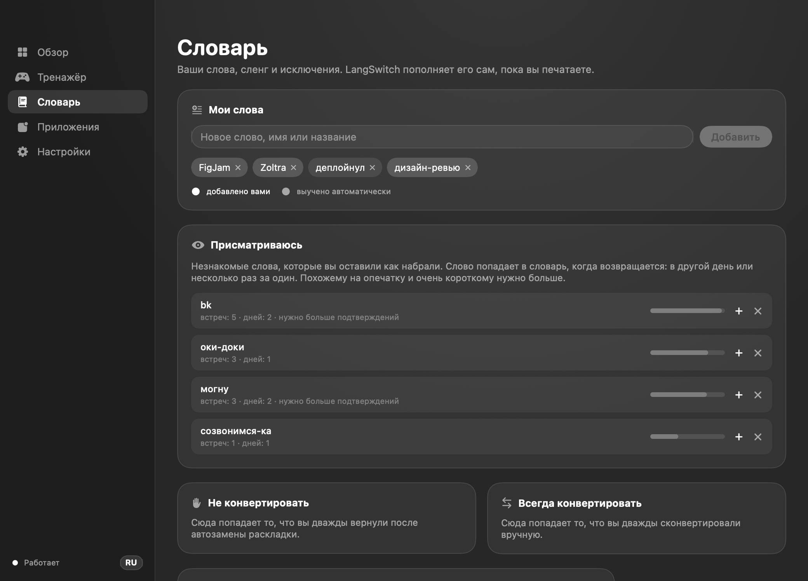

<p align="center">
  
</p>

<h1 align="center">LangSwitch</h1>

<p align="center">
  Пишите, не думая о раскладке. LangSwitch на лету исправляет раскладку, опечатки и пунктуацию<br>
  в любом приложении macOS — и учит печатать вслепую.
</p>

<p align="center">
  <a href="https://github.com/AndySobol/LangSwitch/actions/workflows/ci.yml"></a>
  
  
  
</p>

<p align="center"><a href="README.en.md">English</a></p>



## Что он делает

Вы печатаете `Ghbdtn^ vtyz pjden Fyyf b z lbpfqyth d Vjcrdt!` — в поле появляется
«Привет, меня зовут Анна и я дизайнер в Москве!», а раскладка уже переключена.

Вы печатаете `Z hf,jnf. d figma e;t 12 ktn` — получается «Я работаю в Figma уже 12 лет».
`figma` не превращается в «ашпьф»: это название, и LangSwitch их знает.

| | |
| --- | --- |
| **Раскладка** | Исправляет слово уже после четырёх букв, не дожидаясь пробела. Определяет язык по словарям, частотам и статистике букв. Не трогает `git`, `GitLab`, `gmail`, `a.sobolev`, ссылки, почту, `camelCase` и код. |
| **Орфография** | Модель ошибок вместо списка слов: промахи рук (переставленные, пропущенные, удвоенные буквы) и правила языка — мягкий знак, гласные после шипящих, парные согласные, непроизносимые, приставки, слитно/раздельно/через дефис. «првиет» → «привет», «любиш» → «любишь», «зделать» → «сделать», «вобщем» → «в общем», «как-будто» → «как будто», `recieve` → `receive`. Учитывает предыдущее слово: «включить ео» → «включить его». Словарь частот — 124 тыс. русских и 43 тыс. английских форм. |
| **Пунктуация** | Запятые перед «что», «чтобы», «который», «а», «но», «если»; пробел после запятой; заглавная буква в начале предложения; «ПРивет» → «Привет»; `figma` → `Figma`. |
| **Автодополнение** | Серый текст после каретки, принимается клавишей <kbd>Tab</kbd>. Учится на ваших словах. |
| **Варианты слова** | Двойной клик по слову в любом поле — список замен: написание, формы слова, синонимы. |
| **Тренажёр** | Слепая печать как игра: скорость, серии, уровни, рекорды. Тренирует слова, в которых ошибаетесь именно вы. |
| **«Чёлка»** | Исправление «было → стало» на секунду появляется из выреза экрана MacBook. |

Работает везде, где можно печатать: браузеры (включая адресную строку), Telegram, Teams, Zoom, Slack,
почта, Заметки, ChatGPT, Codex. В терминалах и редакторах кода по умолчанию исправляется только
раскладка.



## Установка

1. Скачайте `LangSwitch-x.y.z.dmg` со страницы [релизов](https://github.com/AndySobol/LangSwitch/releases)
   и перетащите приложение в «Программы».
2. Сборки пока не нотарифицированы. При первом запуске откройте «Системные настройки →
   Конфиденциальность и безопасность» и нажмите «Всё равно открыть».
3. Разрешите «Универсальный доступ» — приложение само покажет, где.

Нужны macOS 15 или новее и две раскладки: русская и латинская (ABC, U.S. и подобные).

<details>
<summary>Сборка из исходников</summary>

```bash
git clone https://github.com/AndySobol/LangSwitch.git
cd LangSwitch
./scripts/build.sh
open dist/LangSwitch.app
```

Нужен Xcode 26. Зависимостей нет, сеть при сборке не используется.

</details>

## Управление

| Действие | Клавиши |
| --- | --- |
| Отменить последнее исправление | <kbd>⌫</kbd> сразу после него |
| Сменить раскладку последнего слова или выделения | <kbd>⇧</kbd> <kbd>⇧</kbd> или <kbd>⌃</kbd><kbd>⌥</kbd><kbd>L</kbd> |
| Исправить выделенный текст | <kbd>⌃</kbd><kbd>⌥</kbd><kbd>F</kbd> |
| Варианты для выделенного слова | двойной клик или <kbd>⌃</kbd><kbd>⌥</kbd><kbd>S</kbd> |
| Принять автодополнение | <kbd>Tab</kbd> |
| Пауза | <kbd>⌃</kbd><kbd>⌥</kbd><kbd>P</kbd> |

Все сочетания меняются в настройках. Каждый вид исправлений — раскладка, орфография, пунктуация,
заглавные буквы, автодополнение — включается отдельно.

LangSwitch учится на ваших действиях и сам ведёт личный словарь. За незнакомым словом, которое вы
оставили как набрали («могну», «оки-доки», название проекта), он присматривается: слово попадает в
словарь, когда возвращается — в другой день или несколько раз за один; похожему на опечатку и очень
короткому нужно больше подтверждений. В разделе «Словарь» видно, за чем он наблюдает и насколько близко
слово к словарю; любое можно добавить сразу, удалить или запретить запоминать. Конвертация, которую вы
дважды отменили, больше не повторяется.



## Приватность

LangSwitch видит нажатия клавиш — иначе исправлять на лету невозможно. Поэтому:

- он работает полностью офлайн, сетевого кода в приложении нет;
- пароли ему недоступны: защищённый ввод macOS не показывает нажатия ни одной программе;
- в памяти держится только текущее слово и несколько предыдущих;
- на диск пишутся счётчики и личный словарь; сбор фраз для тренажёра выключен по умолчанию.

Подробно — в [docs/PRIVACY.md](docs/PRIVACY.md) и [SECURITY.md](SECURITY.md).

## Как это устроено

Один нативный процесс на Swift 6 без внешних зависимостей, около 10 МБ. Нажатия перехватывает
`CGEventTap` на отдельном потоке; на границе слова движок читает набранное в обеих раскладках и
сравнивает прочтения по словарям Hunspell, частотам и триграммной модели. Правка вносится теми же
клавиатурными событиями, поэтому работает в любом поле и не ломает Undo приложения.

Решение на границе слова занимает около 0,8 мс; в покое приложение не использует таймеры.
Подробности — в [docs/ARCHITECTURE.md](docs/ARCHITECTURE.md), проверки — в [docs/qa](docs/qa).

## Разработка

```bash
./scripts/check.sh   # контрольные суммы, секреты, линтер, сборка, тесты
```

См. [CONTRIBUTING.md](CONTRIBUTING.md).

## Лицензия

Код — [MIT](LICENSE). Словари, Hunspell и языковые данные распространяются на своих условиях
(частотный список — CC BY-SA 4.0, модель контекста — CC BY 2.0 FR) —
см. [THIRD_PARTY_NOTICES.md](THIRD_PARTY_NOTICES.md) и [docs/DATA.md](docs/DATA.md).
