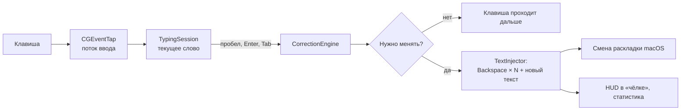

# Архитектура

LangSwitch — один процесс без внешних зависимостей. Пакет SwiftPM состоит из четырёх целей.

| Цель | Что внутри | Зависит от |
| --- | --- | --- |
| `LangSwitchCore` | Раскладки, решение о конвертации, орфография, пунктуация, машина состояний набора, автодополнение, логика тренажёра, данные самообучения. Чистый Swift без AppKit. | — |
| `CHunspell` | Вендорный Hunspell 1.7.6 (C++). | — |
| `LangSwitchLexicon` | Словари RU/EN, обёртка над Hunspell, генератор словоформ, сборка языкового стека. | Core, CHunspell |
| `LangSwitch` | Приложение: перехват клавиатуры, ввод текста, окна, строка меню, «чёлка», тренажёр. | Core, Lexicon |

## Путь одного нажатия

1. **Перехват.** `CGEventTap` уровня сессии видит нажатия раньше приложений. Его источник живёт на
   отдельном потоке (`RunLoopExecutor`), а не на главном: обработчик вызывается на каждое нажатие во всей
   системе, и занятый интерфейс не должен превращаться в задержку набора.
2. **Сессия.** `TypingSession` собирает текущий «кусок» — всё между двумя пробельными границами — из
   нажатий. Экран она не читает. Клик, стрелки, сочетание с ⌘/⌃, смена окна — и состояние стирается:
   исправление применяется только к тексту, набор которого программа видела символ за символом.
3. **Решение.** На границе слова кусок читается дважды: как набран и как дали бы те же клавиши в другой
   раскладке. `LayoutDecider` сравнивает два прочтения по словарям, частотам, списку терминов и
   триграммной модели букв; при сомнении текст остаётся как есть.
4. **Правка.** Граничная клавиша задерживается, в поле уходят Backspace × N и новый текст (Unicode-события
   клавиатуры), затем граничная клавиша доставляется. События вставляются через `tapPostEvent`, то есть
   раньше любых клавиш, которые пользователь успел нажать следом. Этот механизм одинаково понимают
   нативные поля, браузеры и Electron, и он сохраняет собственный Undo приложения.
5. **Раскладка.** После конвертации системная раскладка переключается. Text Input Sources работает только
   на главном потоке, поэтому между решением и фактическим переключением есть несколько миллисекунд;
   клавиши, нажатые в этот промежуток, движок переписывает сам.

## Как принимается решение о раскладке

`LayoutDecider.decide` получает два прочтения и контекст (язык предыдущих слов, было ли ручное
переключение):

- набранное целиком из известных слов → не трогаем (`figma`, `git`, `hello,`);
- исключение — пунктуация в неестественном месте, которая в другой раскладке является буквой
  (`;bk` → «жил», `jib,rf` → «ошибка»);
- набранное неизвестно, а другое прочтение известно → конвертируем, если набранное само не похоже на
  слово (фамилии, новый сленг защищает буквенная модель);
- оба прочтения известны → конвертируем, только если другое — частое слово, набранное — редкое, и
  контекст не подтверждает язык набранного;
- оба неизвестны → сравнение правдоподобия по триграммам с большим запасом.

Ссылки, почта, пути, `camelCase`, `snake_case`, идентификаторы с цифрами защищены до всякого анализа.
Ручная конвертация (двойной Shift) учится: два раза — и появляется постоянное правило. Двойной Shift
сразу после автоматической правки отменяет её; отмена конвертации запоминается как «это не трогать»,
отмена орфографической правки сразу добавляет слово в личный словарь. Backspace по умолчанию ничего не
отменяет и ничему не учит (включается в настройках).

## Как исправляются опечатки

`SpellingCorrector` не содержит таблицы «частых ошибок». Слово исправляется, потому что модель может
объяснить, как оно получилось, — поэтому те же правила работают для слов, которых никто не перечислял.

1. **Как ошибаются.** Кандидаты строятся из трёх семейств правок, у каждой своя цена:
   - *промахи рук* — переставленные соседние буквы, пропущенная, удвоенная, лишняя буква, соседняя клавиша;
   - *границы слов* — пропущенный пробел («вточности»), дефис («ктото», «подружески»), лишний дефис
     («как-будто», «буд-то»), апостроф (`dont`);
   - *правила орфографии* (`Orthography`, данные на язык): безударные гласные, парные согласные, мягкий и
     твёрдый знак, гласные после шипящих и «ц», непроизносимые согласные, приставки на з/с и пре-/при-,
     удвоенные согласные, частицы через дефис и раздельно; для английского — удвоенные согласные,
     безударные гласные, немая `e`.
2. **Что является словом.** Кандидат обязан быть в словаре; частотные слова предпочтительнее
   (`FrequencyList`: ядро из 5 тыс. форм и расширение до 125 тыс. русских и 43 тыс. английских). Слово с
   дефисом проверяется по частям и по правилам дефиса: Hunspell принимает любую пару слов через дефис.
3. **Что стоит рядом.** `ContextModel` хранит, сколько раз одно слово следует за другим в живых
   предложениях. Кандидат, который встречался после предыдущего слова, получает преимущество: «включить
   ео» → «его», а не «ело». Разделение на два слова («вобщем» → «в общем») опирается на то, что эти
   слова встречаются рядом. Запроса к файлам при наборе нет: модель читается из памяти двоичным поиском.
4. **Насколько правке можно верить.** `CorrectionPolicy` взвешивает лучшего кандидата по признакам:
   вид правки, частотность, контекст, расстояние до следующего объяснения, длина слова, правдоподобие
   набранного. Веса подобраны на корпусах (`scripts/train-correction-policy.py`), порог — 0,78. Что не
   прошло порог, не применяется, а предлагается в списке замен.

Поверх оценки остаются жёсткие правила: смешанный регистр (`iPhone`) не трогается; слово с заглавной
внутри предложения считается именем; опечатка внутри части составного слова только предлагается.

То же знание защищает от ложной смены раскладки: если набранное лучше объясняется опечаткой в текущем
языке («руук» — это «руку», а не `heer`), конвертации нет. Пробел, съехавший на букву («н ето», «та
ки»), чинится, когда получившиеся слова встречаются рядом, а у самого слова нет объяснения, подходящего
к предыдущему.

Слова из двух-трёх букв без контекста не исправляются: «го» не отличить от опечатки в «его».

Всё воспроизводимо: `LANGSWITCH_ANALYSIS=<файл> swift test -c release -Xswiftc -enable-testing --filter
corpusAnalysis` выгружает кандидатов и признаки по каждому слову корпусов;
`LANGSWITCH_PROBE="слово,предыдущее слово" swift test --filter probe` показывает, что движок думает о
конкретных словах. Откуда берутся данные — [DATA.md](DATA.md).

## Изоляция и потоки

| Домен | Что там живёт |
| --- | --- |
| `@InputActor` (свой поток с run loop) | Event tap, `InputEngine`, `TypingSession`, словари Hunspell, данные обучения |
| `@MainActor` | Интерфейс, `AppModel`, Text Input Sources, окна HUD и подсказок |
| Фоновые задачи | Запросы Accessibility (позиция каретки, выделение), запись файлов |

Словарные handle Hunspell не `Sendable` и никогда не покидают поток ввода. С главным потоком движок
общается значениями (`EngineConfig`, `InputEvent`, `LearningData`).

Документированные исключения из проверок конкурентности — их три, и расширять список нельзя без причины:

- `RunLoopExecutor` — `@unchecked Sendable`: исполнитель с собственным потоком, как и положено
  пользовательскому `SerialExecutor`;
- `InputActor.assumeIsolated` — синхронный вход в актор из C-обработчика, который и так вызывается на
  потоке ввода (та же форма, что у `MainActor.assumeIsolated`; поток проверяется во время исполнения);
- `TapInvocation` — обёртка аргументов C-обработчика; данные поток не покидают.

## Ресурсы в покое

- Таймеров и опроса нет. Окна HUD, подсказки и списка вариантов существуют, только пока показаны.
- Анимация частиц в тренажёре ставится на паузу, когда частиц нет.
- Сохранение на диск откладывается и объединяется: не чаще раза в несколько секунд и только после набора.
- Единственная периодическая работа — проверка разрешения «Универсальный доступ» раз в полторы секунды,
  и только пока оно не выдано. После запуска перехвата она прекращается.

## Почему нет внешних библиотек

Проверялись Vortex и Pow (анимации), KeyboardShortcuts (горячие клавиши). Все три полагаются на
`Bundle.module`, а сгенерированный SwiftPM-код ищет ресурсный бандл рядом с исполняемым файлом или по
абсолютному пути машины сборки — в собранном вручную `.app` это падение на чужом Mac. Поэтому частицы
нарисованы на `Canvas`, анимации — стандартные `spring`, `symbolEffect`, `contentTransition`,
`MeshGradient`, а запись сочетаний клавиш — локальный монитор событий. По той же причине собственные
ресурсы ищет `ResourceLocator`, сначала в `Contents/Resources`.

## Ограничения

- Запятые ставятся по узким правилам с высокой точностью. Полного синтаксического разбора нет:
  конструкции, где знак зависит от смысла, не трогаются.
- Синонимы берутся из встроенного тезауруса; словоформы — из аффиксных правил словаря.
- Поля, где набор идёт не обычными клавишами (IME, диктовка), не обрабатываются.
- В адресных строках с выделенной подсказкой автозамена пропускается, чтобы не повредить текст.
